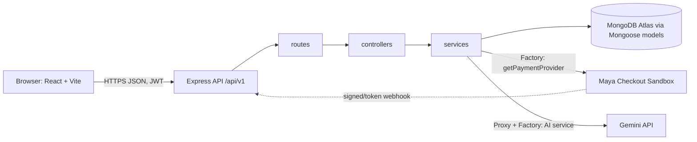
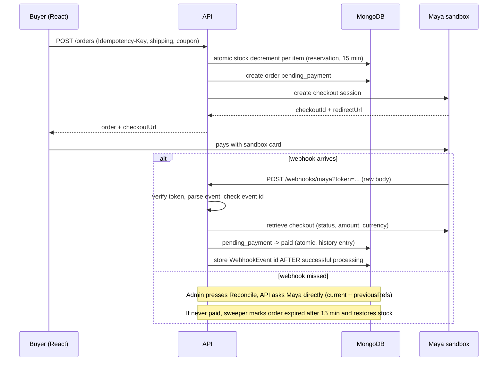
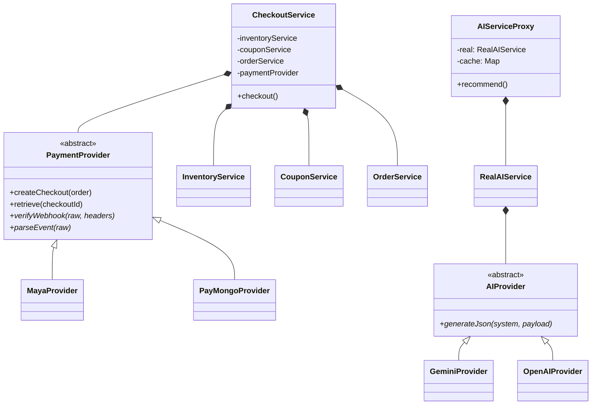
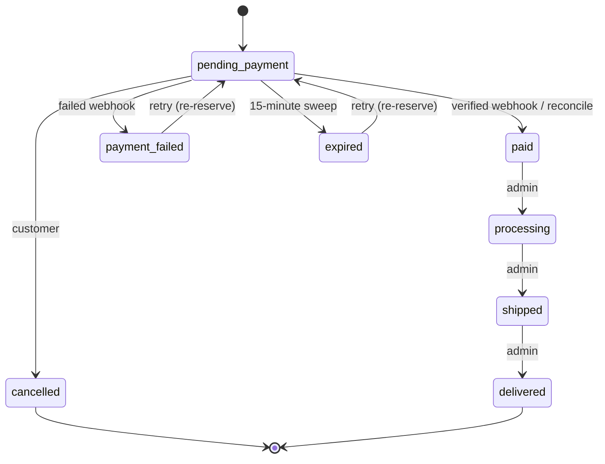

# Architecture

## Layered / context diagram

Trusted boundary: the browser is **untrusted** (client totals are ignored); routes/controllers/services/models, the database, and all provider keys are **trusted backend only**. Layers: **routes** (URL + validation + auth middleware) -> **controllers** (HTTP only) -> **services** (business rules) -> **models** (Mongoose). No database queries live in routes.

## Use cases
```mermaid
usecaseDiagram
  actor Customer
  actor Admin
  actor Gateway as Payment gateway
  actor AI as Gemini
  Customer --> (Register / sign in)
  Customer --> (Browse, search, filter catalog)
  Customer --> (Add unique item to cart)
  Customer --> (Make an offer below listing price)
  Customer --> (Checkout with coupon and 15-minute hold)
  Customer --> (Pay / retry / cancel order)
  Admin --> (Manage products, stock, coupons)
  Admin --> (Accept or reject offers)
  Admin --> (Advance order status / reconcile payment)
  Admin --> (View sales dashboard)
  Customer --> (Ask AI shopping assistant)
  (Checkout with coupon and 15-minute hold) --> Gateway : hosted checkout
  Gateway --> (Verify webhook + retrieve payment) : signed callback
  (Ask AI shopping assistant) --> AI : grounded candidates only
```

## Checkout sequence (with webhook and missed-webhook paths)

The browser redirect after payment is informational only. Only the verified webhook or reconcile can mark an order paid. If a gateway-confirmed payment arrives after expiry, `recoverPaidOrder()` re-reserves stock and coupon, then moves `expired -> pending_payment -> paid` with history, or flags the order if the item is gone.

## Class / module model (abstract class, inheritance, composition)

`PaymentProvider` and `AIProvider` throw on unimplemented operations (`backend/src/services/payment/PaymentProvider.js`, `backend/src/services/ai/AIProvider.js`). Concrete providers are selected at runtime by factories. `CheckoutService` uses **composition** of collaborators instead of inheriting them. See `docs/design-patterns-oop.md` for the full trace and trade-offs.

## Order state machine

Anything not on an arrow returns 409 `ILLEGAL_TRANSITION`; every transition appends `{from, to, actor, at}` to `order.history`.
