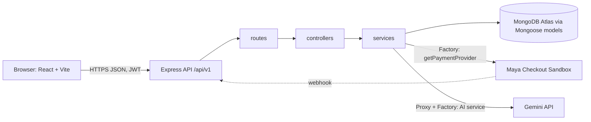
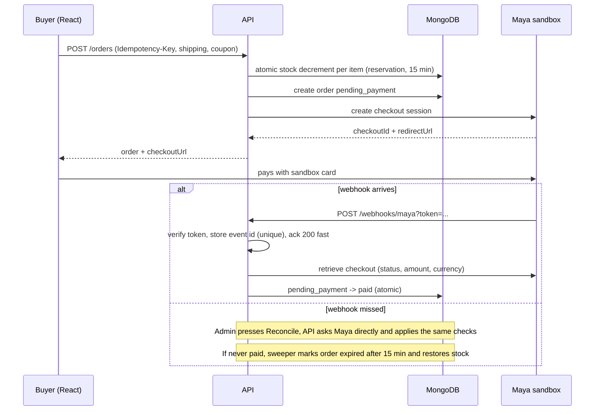

# Architecture

## Layered / context diagram

Layers: **routes** (URL + validation + auth middleware) -> **controllers** (HTTP only) -> **services** (business rules) -> **models** (Mongoose). No database queries live in routes.

## Checkout sequence (with webhook and missed-webhook paths)

The browser redirect after payment is informational only. Only the verified webhook or reconcile can mark an order paid.

## Order state machine
`pending_payment -> paid | cancelled | expired | payment_failed`, then `paid -> processing -> shipped -> delivered`. Illegal moves return 409 `ILLEGAL_TRANSITION`.
