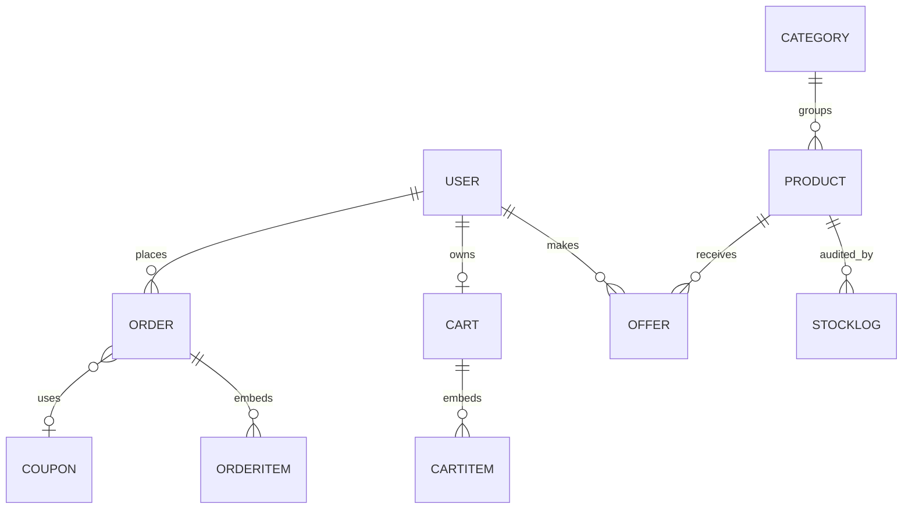

# Database design (MongoDB + Mongoose)

| Collection | Key fields | Constraints / indexes |
|---|---|---|
| users | name, email, password (bcrypt), role | unique email |
| categories | name | unique name |
| products | name, brand, description, price (centavos), stock, condition, size, category, status | index name, brand; stock >= 0 |
| stocklogs | product, previous, current, reason, actor | audit trail of admin stock changes |
| carts | user, items[{product, qty}] | unique user |
| coupons | code, type, value, minSpend, expiresAt, usageLimit, usedCount, perUserLimit | unique code |
| orders | user, items (snapshot of name and price), subtotal, discount, shipping, total, status, history[], expiresAt, idempotencyKey, gatewayRef, paymentId, flag | unique (user, idempotencyKey); unique sparse gatewayRef |
| webhookevents | eventId, type | unique eventId (replay protection) |
| offers | product, buyer, amount, status | index product, buyer |

Money is stored as integer centavos. Order items snapshot the price so later price edits never change history.

Seed: `npm run seed` (adds data, safe to re-run). `npm run reset` wipes everything first.
